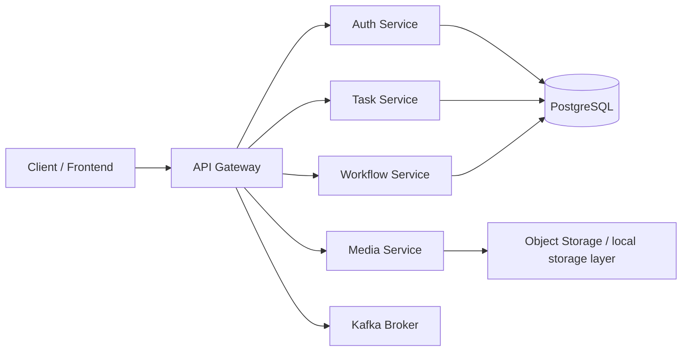

# WRKR SERVICES

A modular TypeScript microservice backend built for secure task management, file attachment handling, and workflow tracking. The system exposes a single API gateway in front of multiple services, centralizes authentication and authorization, and uses Kafka for event-driven integrations.

## Short GitHub Description

TaskFlow is a TypeScript microservices platform for task management, authentication, media uploads, and workflow orchestration, built with Express, JWT, Kafka, and Docker.

## Table of Contents

- [Overview](#overview)
- [Features](#features)
- [Tech Stack](#tech-stack)
- [Architecture](#architecture)
- [Project Structure](#project-structure)
- [Prerequisites](#prerequisites)
- [Environment Variables](#environment-variables)
- [Getting Started](#getting-started)
- [Running the Services](#running-the-services)
- [API Documentation](#api-documentation)
- [Database & Migrations](#database--migrations)
- [Security Features](#security-features)
- [Error Handling & Logging](#error-handling--logging)
- [Deployment Notes](#deployment-notes)
- [Contributing](#contributing)
- [License](#license)

## Overview

This project follows a service-oriented architecture where each business capability runs as an independent Express service:

- Auth Service: registration, login, token validation, identity lookup
- Task Service: task creation, retrieval, and deletion
- Media Service: upload and listing of attachments for tasks
- Workflow Service: workflow retrieval based on task context
- API Gateway: central entry point, request routing, rate limiting, security headers, and proxying
- Shared Package: common middleware, JWT helpers, validation, Kafka utilities, logging, and error handling

The repository is designed for easy local development with `npm workspaces`, TypeScript, and Docker-based Kafka infrastructure.

## Features

- Centralized API gateway with request proxying
- JWT-based authentication and RBAC checks
- Role-based authorization for admin-only actions
- Structured validation using Zod
- File upload support for task attachments
- Service-to-service routing through a shared middleware layer
- Kafka-ready event utilities and topic constants
- Consistent API response format and error handling
- HTTP request logging with Pino
- Dockerized Kafka setup for event streaming
- PostgreSQL migration scripts for database setup

## Tech Stack

| Layer | Technologies |
| --- | --- |
| Runtime | Node.js, TypeScript |
| Web Framework | Express |
| Authentication | JWT, bcryptjs |
| Validation | Zod |
| Messaging | KafkaJS |
| Database | PostgreSQL |
| File Uploads | Multer |
| Logging | Pino |
| API Gateway | Express proxy middleware, Helmet, CORS, rate limiting |
| Dev Tools | tsx, TypeScript, Docker |
| Package Management | npm workspaces |

## Architecture



### Request Flow

1. The client sends a request to the API Gateway.
2. The gateway applies rate limiting, security headers, and request logging.
3. The gateway routes the request to the appropriate downstream service.
4. Services validate input and authenticate the user using JWT claims.
5. Protected operations are checked against RBAC rules.
6. Kafka can be used for asynchronous events or integration workflows.

## Project Structure

```text
new-microservice/
├── apps/
│   ├── api-gateway/
│   │   ├── src/
│   │   │   ├── middleware/
│   │   │   │   └── gatewayAuth.ts
│   │   │   └── index.ts
│   │   └── package.json
│   ├── auth-service/
│   │   ├── src/
│   │   │   ├── controllers/
│   │   │   ├── repositories/
│   │   │   ├── routes/
│   │   │   ├── schemas/
│   │   │   ├── services/
│   │   │   ├── types/
│   │   │   ├── utils/
│   │   │   └── index.ts
│   │   └── package.json
│   ├── media-service/
│   │   ├── src/
│   │   │   ├── controllers/
│   │   │   ├── middlewares/
│   │   │   ├── repositories/
│   │   │   ├── routes/
│   │   │   ├── services/
│   │   │   ├── utils/
│   │   │   └── index.ts
│   │   └── package.json
│   ├── task-service/
│   │   ├── src/
│   │   │   ├── controllers/
│   │   │   ├── repositories/
│   │   │   ├── routes/
│   │   │   ├── schema/
│   │   │   ├── services/
│   │   │   ├── utils/
│   │   │   └── index.ts
│   │   └── package.json
│   └── workflow-service/
│       ├── src/
│       │   ├── controllers/
│       │   ├── repositories/
│       │   ├── routes/
│       │   ├── services/
│       │   ├── utils/
│       │   └── index.ts
│       └── package.json
├── packages/
│   └── shared/
│       ├── src/
│       │   ├── auth/
│       │   ├── db/
│       │   ├── errors/
│       │   ├── kafka/
│       │   ├── logger/
│       │   ├── middleware/
│       │   ├── response/
│       │   ├── validation/
│       │   └── index.ts
│       └── package.json
├── docker/
│   └── docker-compose.yml
├── scripts/
│   └── db-migrate.ts
├── sql/
│   ├── 001_users.sql
│   ├── 002_tasks.sql
│   ├── 003_attachments.sql
│   └── 004_workflows.sql
├── package.json
├── tsconfig.base.json
└── README.md
```

## Prerequisites

Before running the project, make sure you have the following installed:

- Node.js 20+
- npm or yarn
- Docker Desktop or a Docker engine
- PostgreSQL (if you are connecting to a local database)
- A terminal with access to the local environment

## Environment Variables

Create a root `.env` file (or environment variables in your local shell) with the values required by the services.

Example:

```env
PORT=3000
JWT_SECRET=your_super_secret_key
JWT_EXPIRES_IN=7d
GATEWAY_SECRET=your_gateway_secret
AUTH_SERVICE_URL=http://localhost:3001
TASK_SERVICE_URL=http://localhost:3002
MEDIA_SERVICE_URL=http://localhost:3003
WORKFLOW_SERVICE_URL=http://localhost:3004
DB_HOST=localhost
DB_PORT=5432
DB_USER=postgres
DB_PASSWORD=postgres
DB_NAME=taskflow
```

> Note: the repository currently includes shared JWT and gateway auth utilities, but environment setup should be validated against your local infrastructure before production use.

## Getting Started

### 1. Install dependencies

```bash
npm install
```

### 2. Start Kafka with Docker

```bash
npm run kafka:up
```

### 3. Start services in development mode

```bash
npm run dev:gateway
npm run dev:auth
npm run dev:task
npm run dev:media
npm run dev:workflow
```

### 4. Or run them individually from each service

```bash
cd apps/auth-service && npm run dev
cd apps/task-service && npm run dev
cd apps/media-service && npm run dev
cd apps/workflow-service && npm run dev
cd apps/api-gateway && npm run dev
```

## Running the Services

The root workspace defines scripts for each service:

```json
{
  "scripts": {
    "dev:auth": "npm run dev -w auth-service",
    "dev:gateway": "npm run dev -w api-gateway",
    "dev:task": "npm run dev -w task-service",
    "dev:media": "npm run dev -w media-service",
    "dev:workflow": "npm run dev -w workflow-service",
    "db:migrate": "tsx scripts/db-migrate.ts",
    "kafka:up": "docker compose -f docker/docker-compose.yml up -d",
    "kafka:down": "docker compose -f docker/docker-compose.yml down",
    "kafka:logs": "docker compose -f docker/docker-compose.yml logs -f kafka"
  }
}
```

## API Documentation

All services are exposed from the gateway on the default port `3000` unless overridden.

### Gateway Endpoints

| Method | Endpoint | Service | Description |
| --- | --- | --- | --- |
| `GET` | `/health` | Gateway | Gateway health check |
| `POST` | `/auth/register` | Auth Service | Create a new user |
| `POST` | `/auth/login` | Auth Service | Authenticate and receive a token |
| `GET` | `/auth/me` | Auth Service | Fetch authenticated user details |
| `POST` | `/tasks/create` | Task Service | Create a task |
| `GET` | `/tasks` | Task Service | List tasks |
| `GET` | `/tasks/:id` | Task Service | Get a single task |
| `DELETE` | `/tasks/:id` | Task Service | Delete a task (`ADMIN` only) |
| `POST` | `/tasks/:taskId/attachments` | Media Service | Upload an image attachment |
| `GET` | `/tasks/:taskId/attachments` | Media Service | List attachments for a task |
| `GET` | `/tasks/:taskId/workflows` | Workflow Service | Fetch workflows linked to a task |

### Auth payloads

#### Register

```json
{
  "name": "Jane Doe",
  "email": "jane@example.com",
  "password": "secret123"
}
```

#### Login

```json
{
  "email": "jane@example.com",
  "password": "secret123"
}
```

### Task payload

```json
{
  "title": "Prepare sprint review notes"
}
```

### Authentication header

```http
Authorization: Bearer <jwt_token>
```

### Example curl requests

```bash
# Register
curl -X POST http://localhost:3000/auth/register \
  -H "Content-Type: application/json" \
  -d '{"name":"Jane Doe","email":"jane@example.com","password":"secret123"}'

# Login
curl -X POST http://localhost:3000/auth/login \
  -H "Content-Type: application/json" \
  -d '{"email":"jane@example.com","password":"secret123"}'

# List tasks
curl http://localhost:3000/tasks \
  -H "Authorization: Bearer <token>"

# Upload attachment
curl -X POST http://localhost:3000/tasks/123/attachments \
  -H "Authorization: Bearer <token>" \
  -F "image=@/path/to/file.jpg"
```

## Database & Migrations

The project ships with SQL migration files in the `sql/` directory:

- `001_users.sql`
- `002_tasks.sql`
- `003_attachments.sql`
- `004_workflows.sql`

A migration runner is provided in `scripts/db-migrate.ts` and can be used as follows:

```bash
npx tsx scripts/db-migrate.ts sql/001_users.sql
```

This script loads the SQL file, runs it against the configured Postgres pool, and closes the connection.

## Security Features

The codebase includes several security controls:

- JWT validation for protected routes
- Role-based access control (`authenticate`, `isAdmin`)
- Gateway secret validation support via `requireGatewaySecret`
- Helmet headers for HTTP hardening
- CORS enabled at the API gateway
- Rate limiting on the gateway (`express-rate-limit`)
- Input validation via Zod schemas
- Structured error handling with non-detailed operational errors

### Security Notes

- The gateway currently imports `gatewayAuth` but leaves it commented out in the route setup, which means the secret check is available but not enforced until enabled intentionally.
- For production, enforce HTTPS, rotate secrets, use a managed PostgreSQL service, and configure a secure object-storage backend for file uploads.

## Error Handling & Logging

### Error Handling

The shared package exposes a centralized `AppError` and `errorHandler` implementation. This gives each service a consistent approach to:

- validation failures
- unauthorized access
- not found routes
- operational failures
- service-level exception propagation

### Logging

HTTP logging is configured using `pino-http`:

- `httpLogger` wraps the logger middleware for each request
- `logger` is exported from the shared package for service logger access
- This enables request tracing and operational visibility for API traffic

## Deployment Notes

This codebase is built for a containerized development workflow and can be extended for cloud deployment. Recommended next steps for production:

- Move configuration into a proper secret manager
- Add health checks for each service
- Set up persistent PostgreSQL and object storage
- Add dependency injection or repository layer abstractions
- Implement Kafka consumers and event processors for asynchronous workflows
- Add CI/CD pipelines and test coverage

## Contributing

Contributions are welcome.

1. Fork the repository
2. Create a feature branch
3. Implement your changes with clear commit messages
4. Run the relevant checks and verify the service behavior
5. Open a pull request with a concise explanation of the change

Suggested contribution areas:

- API validation improvements
- RBAC refinements
- Kafka event processing
- Database migration coverage
- Better docs and examples
- Test suites for each service

## License

This project does not currently include a license file. If you plan to publish it publicly, add an appropriate Open Source license such as MIT or Apache-2.0 before release.

---

If you want, this project can also be expanded into a more polished GitHub-ready version with:

- a badges section
- architecture diagram with service ports
- quickstart screenshots
- environment template file
- CI/CD badge setup
- a publish-ready `LICENSE` file
